# Dance with B

The website for **Dance with B**, a small bachata dance business: group classes, workshops, socials and private lessons. Dancers find what's coming up, register, check in at the door and hear about new events; the instructor runs the whole thing from one admin area.

> Screenshots are from a test setup. Photos and flyers are replaced with blurred fractal art, QR codes are blurred, and handles, names and contact details are masked.

  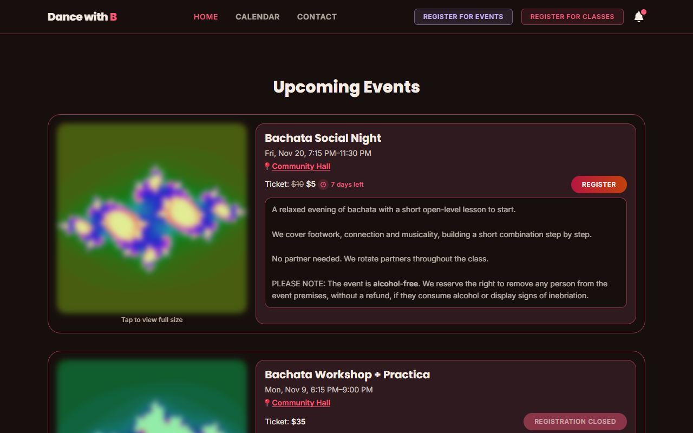
  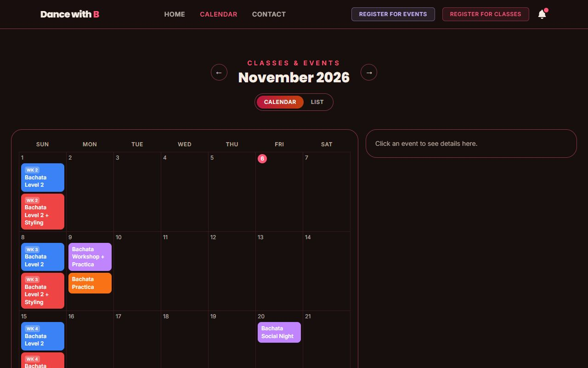

## For dancers

- **Homepage built from flyers.** Each upcoming class, series, workshop and social has its own card: its flyer, dates, location, prices (early-bird and flash-sale prices count down), what the lesson covers, and a Register button. Past flyers stay in a swipeable gallery.
- **Calendar.** Month and list views of every class and event, with details on tap.
- **Registration.** Sign up for one class, a whole series, or several at once (for yourself and friends), with drop-in, series and student prices, bundle deals, and spots left when a class has a cap. A confirmation email follows, with the community guidelines when there are any.
- **Check-in at the door.** Scan the door sign's QR code or open the check-in page, pick your class and check in. Classes can let walk-ins register as drop-ins as they check in.
- **Feedback.** After a class, dancers can be asked a few quick questions by email, WhatsApp or a shared link. Answers are anonymous unless the dancer chooses to share their name.
- **An app on your phone.** The site installs to the home screen on iPhone and Android, and the bell in the header turns on push notifications for new events, workshops and classes. Notifications are opt-in.
- **Contact and private lessons.** A contact form for questions and private coaching requests.

  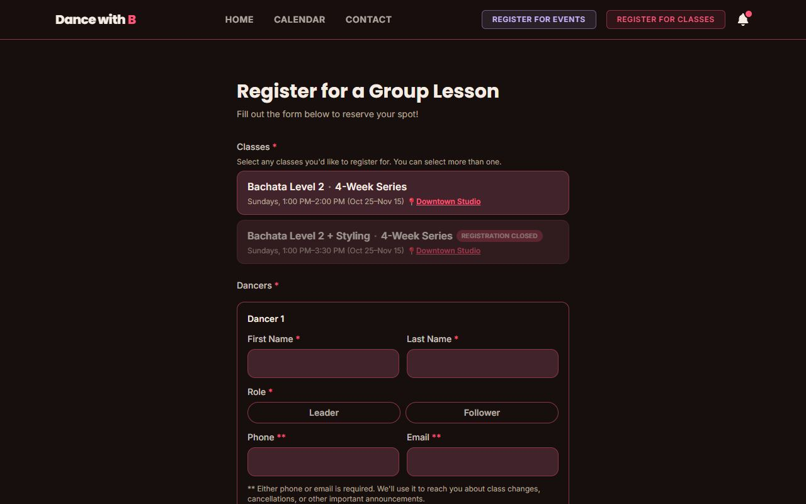
  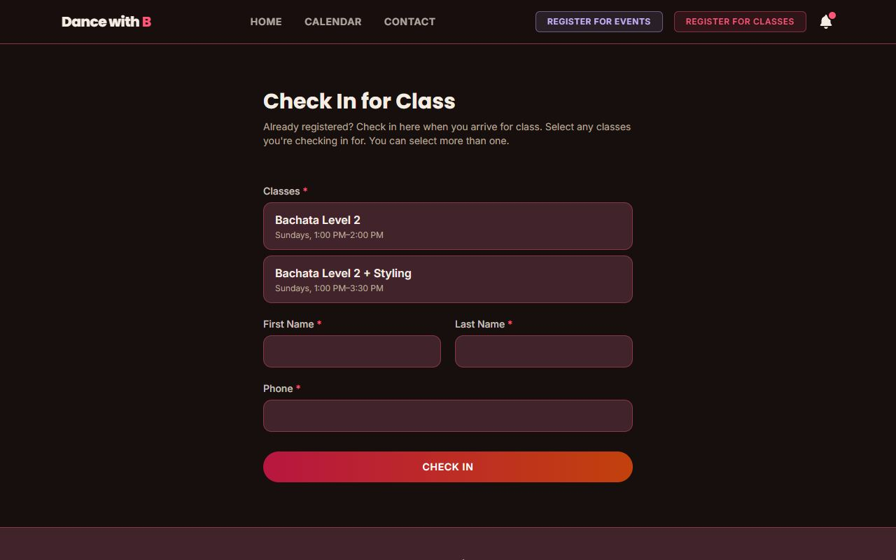

  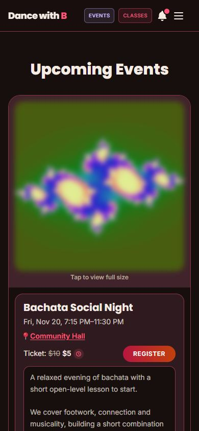
  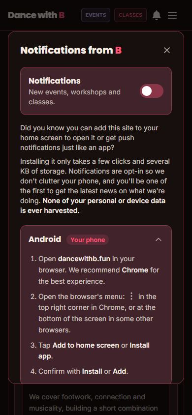

## Admin tools

Signed-in admins get an admin area for running the business day to day:

| Tool | What it does |
| --- | --- |
| **Classes and events** | Add and edit classes, series and events right on the calendar: dates, prices, early-bird and flash sales, capacity (optionally by leaders and followers), flyers, lesson overviews, and classes that go together. Kept in sync with Google Calendar. |
| **Homepage editor** | Reorder the flyer cards, edit deal notes and lesson overviews, and manage the past flyers gallery. |
| **Dancer dashboard** | Sign-ups, event registrations, check-ins and attendance in sortable, filterable tables (compact cards on a phone), with payment tracking, edits, a recycling bin, and help matching check-ins to registrations. |
| **Door signs** | Save a door sign for one or more classes: a branded check-in QR code and a Venmo code for anyone who hasn't paid (Dance with B's or a guest artist's), each with a simple version for older phones. Every sign has its own short link and scan counts, and shows full screen on a tablet or downloads as a picture to print. |
| **Feedback** | Build questionnaires, send them to the dancers who came to a class or event, and see the results by question. |
| **Notifications** | Send a push notification about a class or event (the message fills itself in) and see how many devices showed and opened each one. |
| **Inbox** | Messages from the contact form, with an unread badge in the header. |
| **Deals, guidelines and settings** | Bundle deals, community guidelines, a site-wide announcement banner, which pages show in the menu, the site's time zone, and who gets notified about new sign-ups. |
| **Errors** | A short list of anything that went wrong (a failed email, a calendar sync problem) to look into. |

  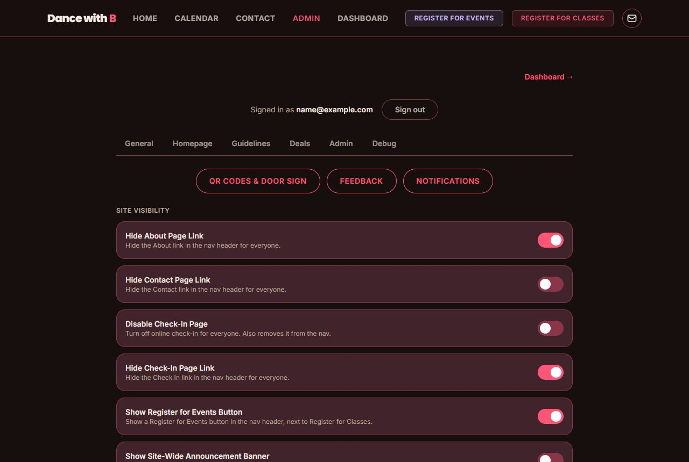
  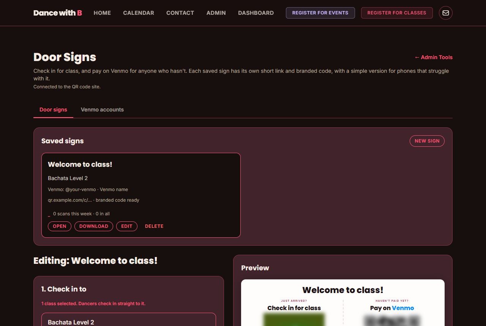

  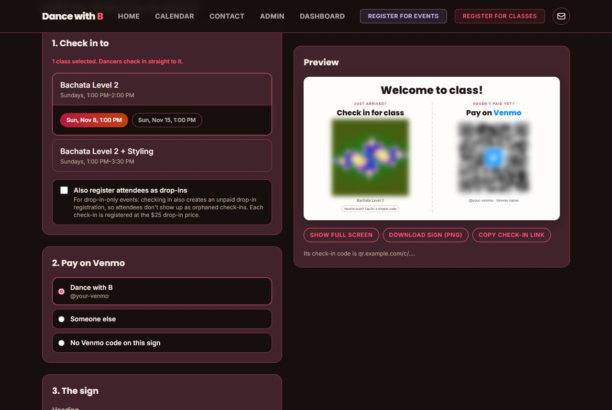
  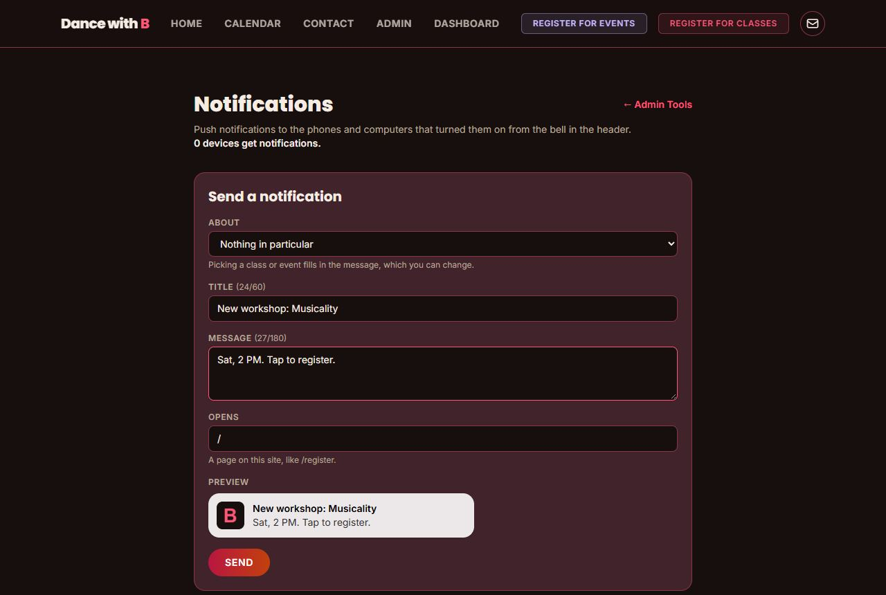

  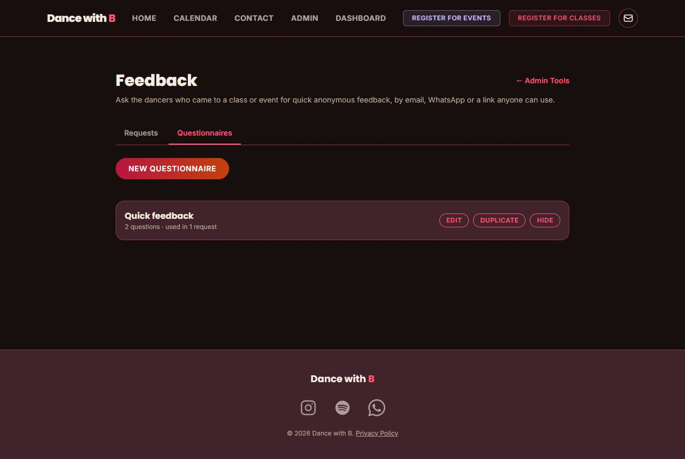

## Built with

- [Astro](https://astro.build) with server rendering, and [Tailwind CSS](https://tailwindcss.com)
- [Supabase](https://supabase.com) for the database and admin sign-in
- [Netlify](https://www.netlify.com) for hosting
- Email confirmations, Google Calendar sync, web push notifications, and a companion branded QR code site

## Privacy

Dancers' contact details are used only for their registrations and class updates, and are never sold or shared. Feedback is anonymous unless the dancer chooses otherwise, and push notifications are opt-in. See the site's privacy policy for details.
